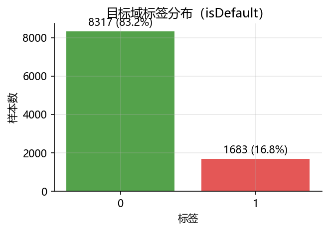
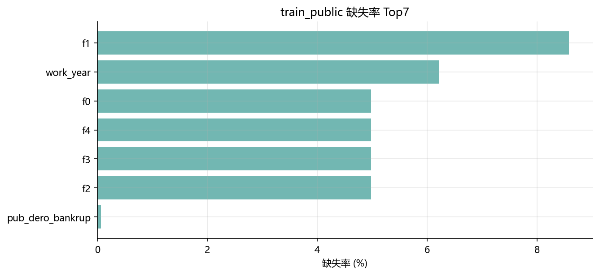
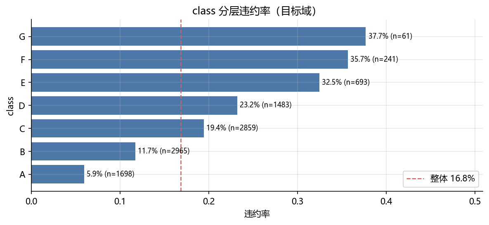
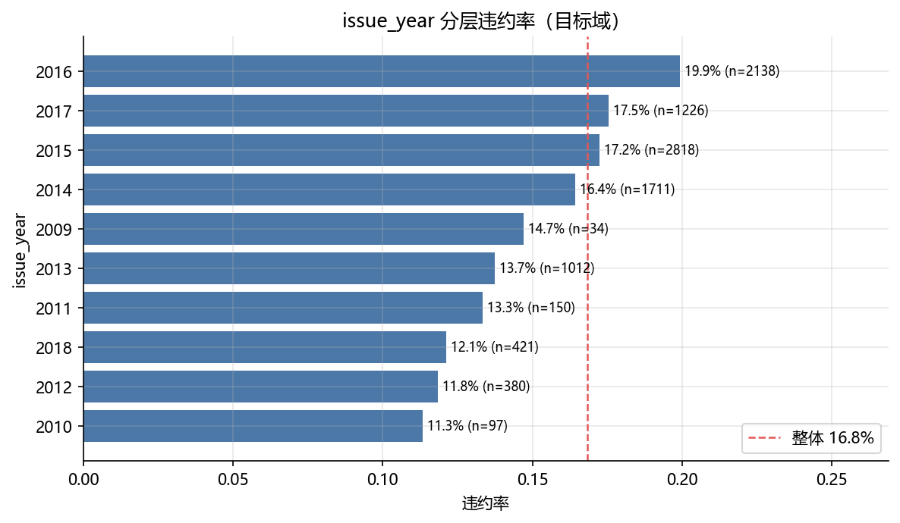
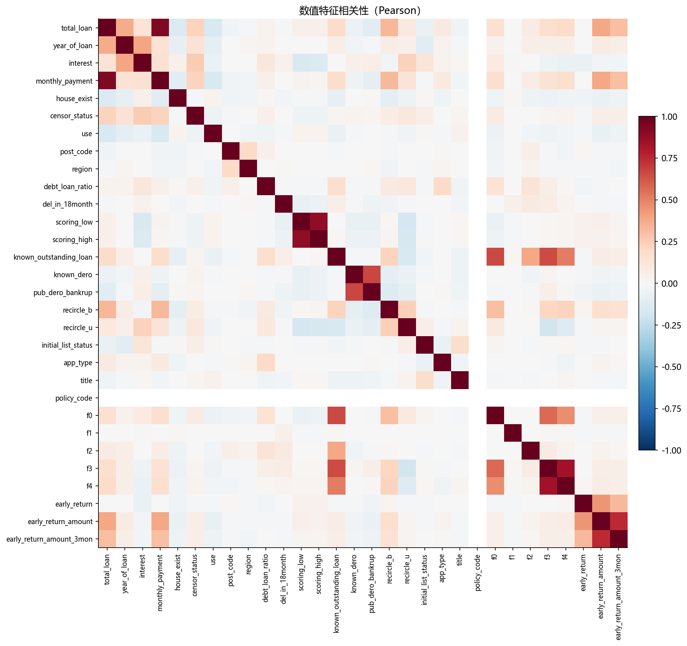
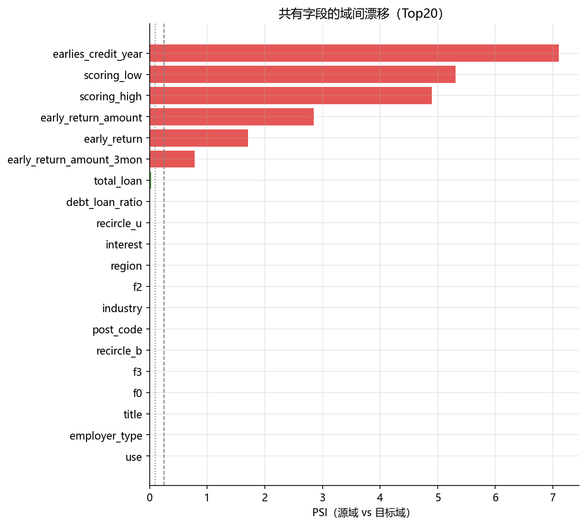

# R1 数据治理与探索性分析

> 对应申请书环节（1）；产出脚本 `scripts/01_eda.py`（`make eda` 一键重跑）；
> 表格在 `reports/tables/`，图在 `reports/figs/`。所有数字均由当前数据实跑得到。

## 0. 五条结论（先看这里）

1. **数据可用且干净**：目标域 10,000×39、源域 750,000×42、测试 5,000×38；两域标签率 16.83% / 19.96%；三表 `loan_id`、`user_id` 均无重复。
2. **`user_id` 不可关联**：源域是 `0..749999` 的稠密编号，与目标域 20 万段的"重合"是编号空间嵌套；同 id 上 27/33 个字段一致率 <50%，判定为伪关联，**禁止 join**（申请书里"按借款人标识关联"的说法据此修正）。
3. **信号集中在提前还款与定价**：互信息前三是 `early_return_amount`(0.123)、`early_return`(0.094)、`early_return_amount_3mon`(0.085)，且方向为负（提前还款越多越不违约）；`interest`(0.027)、`class`(0.023) 次之。单变量信号普遍偏弱，说明增益要靠模型对交互的刻画。
4. **域间漂移只集中在 6 个字段**：`earlies_credit_year`(7.10)、`scoring_low`(5.31)、`scoring_high`(4.90)、`early_return_amount`(2.85)、`early_return`(1.71)、`early_return_amount_3mon`(0.78)；其余 27 个共有字段 PSI < 0.1，可直接迁移。
5. **目标域 `earlies_credit_mon` 是脏字段**：46.7% 的取值形如 `1-Dec`（DD-Mon，年份丢失），53.3% 形如 `Apr-90`；源域则是干净的 `Mar-1984`。该字段在目标域不可直接使用。

## 1. 数据与口径

| 表 | 规模 | 标签 | 标签率 |
|---|---|---|---|
| `train_public`（目标域） | 10,000 × 39 | `isDefault` | 16.83%（8317 / 1683） |
| `train_internet`（源域） | 750,000 × 42 | `is_default` | 19.96% |
| `test_public` | 5,000 × 38 | — | — |

字段构成：35 个共有字段（含 2 个 id）+ 3 个仅目标域（`known_outstanding_loan`、`known_dero`、`app_type`）+ 6 个仅源域（`sub_class`、`work_type`、`house_loan_status`、`marriage`、`offsprings`、`f5`）。测试集列 = 目标域训练集去掉标签列，顺序一致。

## 2. 数据质量

### 2.1 缺失

| 字段 | 目标域 | 源域 | 测试集 |
|---|---|---|---|
| `f1` | 8.58% | 8.72% | 9.08% |
| `work_year` | 6.22% | 5.85% | 5.56% |
| `f0`/`f2`/`f3`/`f4` | 4.98% | 5.04% | 5.18% |
| `pub_dero_bankrup` | 0.07% | 0.05% | 0.08% |
| `recircle_u`（仅源域） | — | 0.07% | — |

测试集缺失结构与训练集几乎一致 → 采样稳定，不需要额外的分布校正。完整表见 `tables/quality_missing.csv`。

### 2.2 异常值（1%/99% 分位，见 `tables/quality_outliers.csv`）

- `debt_loan_ratio`：p99 = 39.3，最大值 999（100 条 >p99），建议截断或标记；
- `interest`：4.78 ~ 33.98，p99 = 27.5，长尾在 30% 以上；
- `total_loan` / `monthly_payment`：p99 分别 39,916 / 1,231，最大值仅略高，分布本身右偏，不需要截断；
- `recircle_b`：p99 = 87,071，最大 779,021，量级跨度大，进模型前应做对数变换；
- `scoring_high` 最大值 1,131.8，超出常规评分区间，需在特征阶段与 `scoring_low` 一起处理。

### 2.3 重复与基数

三表 `loan_id` / `user_id` 重复数均为 0（`tables/quality_duplicates.csv`）。
高基数类别字段：`title` 908、`post_code` 794、`region` 50、`industry` 14 → `title`/`post_code` 必须做长尾截断 + 频次编码，其余可用目标编码。

### 2.4 日期字段

| 字段 | 目标域格式 | 源域格式 | 处理 |
|---|---|---|---|
| `issue_date` | `2016/10/1` | `2015-06-01` | 统一解析为日期，派生年份/月份 |
| `earlies_credit_mon` | `Apr-90`(53.3%) / `1-Dec`(42.6%) / `10-Aug`(4.1%) | `Mar-1984`(100%) | 仅 `Mon-YY`/`Mon-YYYY` 可解析（目标域 53.3%），DD-Mon 记 `NaT` |

`src/dates.py` 已实现解析并在 PSI 中用 `earlies_credit_year` 替代原字段。

## 3. `user_id` 关联性证伪（申请书中"按借款人标识关联"的修正）

| 表 | 行数 | 唯一 id | id 范围 | 是否 0..n-1 稠密 |
|---|---|---|---|---|
| `train_public` | 10,000 | 10,000 | 200,008 ~ 249,997 | 否 |
| `train_internet` | 750,000 | 750,000 | 0 ~ 749,999 | **是** |
| `test_public` | 5,000 | 5,000 | 200,006 ~ 249,998 | 否 |

源域 id 是连续编号，目标域 id 恰好落在其中，于是出现 `public∩internet = 10,000`、`test∩internet = 5,000` 的"完美重合"；但 `loan_id` 两域交集为 0，且同 id 上：

| 字段 | 同 id 一致率 | 字段 | 同 id 一致率 |
|---|---|---|---|
| `policy_code` | 100% | `use` | 39.0% |
| `f1` | 84.0% | `early_return_amount` | 35.4% |
| `pub_dero_bankrup` | 77.1% | `region` | 5.7% |
| `del_in_18month` | 67.2% | `issue_date` / `scoring_high` | 0% |

**结论：这些"同 id"不是同一个人。** 迁移只能走特征空间与样本加权（E2/E3），不能做 id 级 join；`configs/feature_map.yaml` 已把两个 id 标记为 `transferable: false`。

完整表：`tables/id_space.csv`、`tables/id_consistency.csv`。

## 4. 分布与分层违约率（目标域）

| 字段 | 违约率区间 | 观察 |
|---|---|---|
| `class` | **5.9% (A) → 37.7% (G)** | 单调递增，风险分级高度有效 |
| `debt_loan_ratio`（10 分箱） | 12.1% → 24.9% | 债务收入比越高，违约率越高 |
| `use` | 13.0% → 24.1% | 用途 1（116 条）最高，用途 0（占 57.9%）17.7% |
| `work_year` | 14.4% → 24.9% | 弱单调 |
| `house_exist` | 14.4% → 19.4% | 影响小 |
| `industry` | 15.5% → 20.2% | 影响小 |
| `region` | 15.4% → 18.7% | 影响小 |
| `issue_year` | 11.3% (2010) → 19.9% (2016) → 12.1% (2018) | 先升后降，说明**不能忽略时间** |

> 分组样本量 < 30 的稀有类别已并入 OTHER 并从图表中剔除，避免 0%/100% 的假象。

## 5. 关联强度

互信息（连续+离散混合口径）Top 8（完整表 `tables/association.csv`）：

| 字段 | 类型 | Pearson | Spearman | 互信息 |
|---|---|---|---|---|
| `early_return_amount` | 数值 | -0.293 | -0.436 | 0.1226 |
| `early_return` | 数值 | -0.349 | -0.372 | 0.0942 |
| `early_return_amount_3mon` | 数值 | -0.218 | -0.347 | 0.0851 |
| `earlies_credit_mon` | 类别 | — | — | 0.0287 |
| `interest` | 数值 | 0.194 | 0.196 | 0.0273 |
| `class` | 类别 | — | — | 0.0231 |
| `debt_loan_ratio` | 数值 | 0.081 | 0.100 | 0.0107 |
| `f4` | 数值 | 0.008 | -0.004 | 0.0105 |

要点：
- 提前还款三项是最强单变量，且方向为负——提前还款行为与低违约强相关；
- `earlies_credit_mon` 的互信息来自"是否有信用历史"这一信息（可解析 vs 缺失），P2 建议改为 `has_credit_history` 指示变量 + 解析值；
- 共线仅 1 对：`total_loan` ↔ `monthly_payment` = 0.925（`tables/collinearity.csv`），建议保留其一或改用比值 `monthly_payment / total_loan`。

## 6. 域间漂移（PSI，目标域 vs 源域）

完整表 `tables/psi.csv`（含 `psi_test_vs_public` 作对照）。

| 字段 | PSI | 判定 | 解释 |
|---|---|---|---|
| `earlies_credit_year` | 7.10 | 显著 | 目标域 46.7% 缺失 vs 源域 0，主要由缺失造成 |
| `scoring_low` | 5.31 | 显著 | 两域评分体系不同（目标域 540~911，源域另一刻度） |
| `scoring_high` | 4.90 | 显著 | 同上 |
| `early_return_amount` | 2.85 | 显著 | 提前还款金额口径/量级不同 |
| `early_return` | 1.71 | 显著 | 提前还款次数分布不同（源域尾部更重） |
| `early_return_amount_3mon` | 0.78 | 显著 | 同上 |
| 其余 27 个共有字段 | < 0.1 | 稳定 | 含 `total_loan`、`interest`、`debt_loan_ratio`、`recircle_*`、`f0~f4`、全部类别字段 |

补充：`psi_test_vs_public` 全部 < 0.04，说明测试集与训练集同分布，**提交评测不会因分布漂移而失真**。

> 口径说明：本节 PSI 以全量目标域为期望分布计算，仅用于筛选；P3 建模时必须改为"训练折内拟合分箱边界"，否则会引入轻微泄漏。

## 7. 给 P2 的输入（特征工程直接照此执行）

1. **直接迁移（27 个，PSI<0.1）**：`total_loan`、`interest`、`monthly_payment`、`debt_loan_ratio`、`del_in_18month`、`recircle_b/u`、`early_return*` 以外的数值字段、`f0~f4`、全部类别字段。
2. **需域内变换后再迁移**：`early_return`、`early_return_amount`、`early_return_amount_3mon` → `log1p` + 域内分位秩（rank）/ 标准化 + `is_source` 指示。
3. **不建议直接迁移**：`scoring_low/high`（评分体系不同）、`earlies_credit_mon`（目标域 46.7% 缺年份）→ 若使用，必须域内标准化并配缺失指示。
4. **编码策略**：`title`/`post_code` → 频次编码（Top-100 + OTHER）；`class`/`work_year`/`offsprings` → 序数；`industry`/`use`/`employer_type`/`region` → K 折内目标编码；`house_exist`/`censor_status`/`initial_list_status`/`policy_code`/`app_type` → one-hot。
5. **缺失处理**：`f0~f4`、`f1`、`work_year` 用中位数/众数填充 + 缺失指示列；`pub_dero_bankrup` 缺失填 0。
6. **派生特征建议**：`monthly_payment / total_loan`（替代共线的两个原始字段）、`early_return_amount / monthly_payment`、`issue_date - earlies_credit_mon` 的信用历史长度（仅 53.3% 可算 + 缺失指示）、`debt_loan_ratio × del_in_18month`（申请书明确要求）。
7. **防泄漏**：目标编码、分箱边界、标准化参数只在训练折拟合；PSI 分箱同理。

## 8. 产物清单

| 类别 | 文件 |
|---|---|
| 数据质量 | `tables/quality_missing.csv`、`quality_outliers.csv`、`quality_cardinality.csv`、`quality_duplicates.csv` |
| id 关联 | `tables/id_space.csv`、`id_consistency.csv` |
| 分布 | `tables/default_rate_by_{class,work_year,industry,use,house_exist,region,debt_loan_ratio,issue_year}.csv` |
| 关联 | `tables/association.csv`、`collinearity.csv` |
| 漂移 | `tables/psi.csv` |
| 图 | `figs/target_balance.png`、`missing_bars.png`、`default_rate_*.png`(8)、`dist_*.png`(3)、`corr_heatmap.png`、`psi_bar.png` |

## 9. 局限

- 以上均为**单变量**结论，未刻画字段间交互；P3 的模型重要性会给出补充。
- 目标域只有 1 万条，稀有分组（如 `class=G` 仅 61 条）的违约率置信区间很宽，报告中不宜过度解读。
- PSI 用全量目标域计算（见第 6 节口径说明），P3 需在训练折内重算。